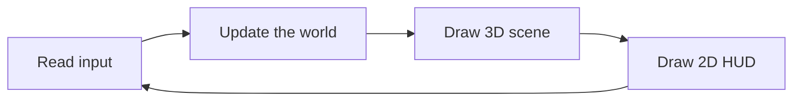
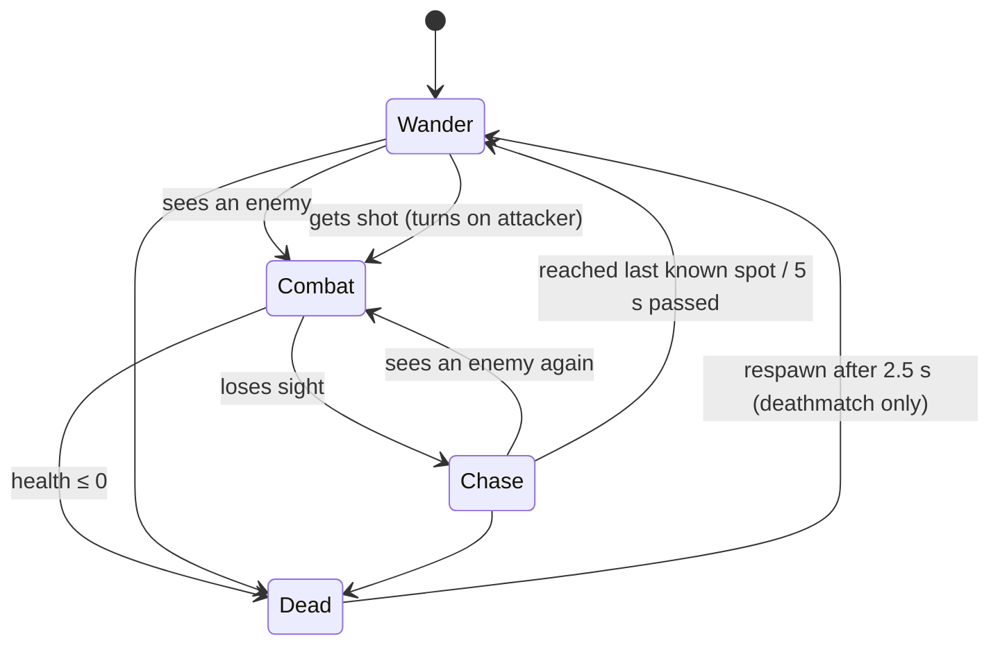
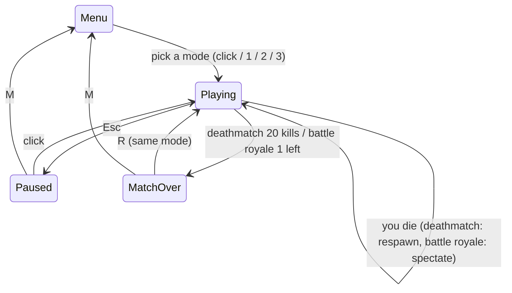

# Game Programming Fundamentals: Building a Krunker-style FPS

This guide explains the ideas behind every part of this project. Read it next to the code. Each section names the file to open.

---

## 0. Is this possible, and why C#?

Yes. Krunker is a fairly simple game technically. It uses blocky maps, flat colors, instant-hit guns and fast movement. Its charm comes from **movement physics** and **game feel**, not from graphics. All of that can be built by hand.

How the options you listed compare for a 3D shooter:

| Option | Good for | For an FPS? |
|---|---|---|
| **C# + .NET (native)** | Games, desktop apps, servers | ✅ Chosen. Fast, easy language, great tools. Unity also uses C#. |
| **Java (native)** | Desktop apps, Minecraft | ✅ Works (LWJGL, libGDX, jMonkeyEngine). Needs a bit more setup. |
| **React Native** | Mobile UI apps | ❌ Built for buttons and lists, not real-time 3D. |
| **C# / .NET Core for web** (ASP.NET) | Websites, web APIs | ⚠️ Good for the *server* of a multiplayer game. The 3D in the browser would be JavaScript/Three.js (what Krunker uses). |
| **Oracle Forms / Reports** | Database business forms and printed reports | ❌ No real-time graphics at all. |

We use **raylib**, a small C library for windows, input and 3D drawing, through the **Raylib-cs** C# wrapper. It is not a full engine like Unity. You write the game loop, physics and collision yourself, which is exactly how you learn the fundamentals.

---

## 1. The game loop

A game is one loop that runs as fast as the screen refreshes (60, 144... times per second). Each pass through the loop is called a **frame**:



In `Game.Run()`:

```csharp
while (!quit && !Raylib.WindowShouldClose())
{
    Update();  // input + simulation
    Draw();    // render
}
```

Every frame takes a slightly different amount of time. `Raylib.GetFrameTime()` returns that duration, called **delta time** or `dt`, in seconds. Anything that changes over time must be multiplied by `dt`:

```csharp
position += velocity * dt;   // meters/second × seconds = meters
```

Without `dt`, the game would run twice as fast on a 120 Hz monitor as on a 60 Hz one.

---

## 2. Fixed timestep: why physics runs at exactly 120 Hz

Even with `dt`, physics behaves *slightly* differently at different frame rates. Jump heights vary a little, and collisions can be missed in a long frame. Competitive games fix this by stepping physics in **identical small steps** (ticks), no matter how often the screen draws.

`Game.UpdatePlaying()`:

```csharp
accumulator += dt;                  // bank the real time that passed
while (accumulator >= TickDt)       // TickDt = 1/120 s
{
    FixedTick(input);               // physics + AI, always the same dt
    accumulator -= TickDt;
}
RenderAlpha = accumulator / TickDt; // fraction of the way to the next tick
```

- At 60 FPS, the loop runs 2 ticks per frame. At 240 FPS, a tick runs only every other frame.
- **Interpolation:** each body remembers `PrevPosition` from the previous tick. Drawing uses `Lerp(Prev, Current, RenderAlpha)`, so motion stays smooth even when the frame rate and tick rate don't line up.
- **Mouse look is not in the tick.** It is applied every frame (`Player.Look`) so aiming never feels delayed.
- **Key presses** (one-time events like "crouch was just pressed") are saved in `pendingCrouchPress` until a tick uses them. Otherwise a press could fall into a frame that runs 0 ticks and get lost.

---

## 3. 3D space, vectors and units

- **Units:** 1 unit = 1 meter. The player is 1.8 m tall and runs at 7.5 m/s.
- **Axes:** X and Z are the ground plane and **Y is up**.
- A **vector** (`System.Numerics.Vector3`) is three numbers. It can mean a *position* (where) or a *direction/velocity* (which way, how fast).

Operations you'll see everywhere:

| Operation | Meaning | Used for |
|---|---|---|
| `a + b`, `a * 2` | move or scale | moving things |
| `Length()` | how long the vector is | distance, speed |
| `Normalize(v)` | same direction, length 1 | "which way" without "how much" |
| `Dot(a, b)` | how much `a` points along `b` (if `b` has length 1) | speed in the direction you want to go; "is it in front of me?" |
| `Cross(a, b)` | a vector perpendicular to both | the "right" direction from "forward" and "up" |
| `Lerp(a, b, t)` | blend from a to b by t (0..1) | smoothing, interpolation |

---

## 4. The first-person camera

Your view direction is stored as two angles (see `MathUtil.Forward`):

- **Yaw** turns left/right around the Y axis.
- **Pitch** tilts up/down. It is clamped to ±89° so you can't flip upside down.

Basic trigonometry turns the angles into a direction:

```
forward = ( sin(yaw)·cos(pitch),  sin(pitch),  cos(yaw)·cos(pitch) )
```

The mouse changes the angles: `Yaw -= mouseDX * sensitivity`. The camera sits at the player's eye and looks at `eye + forward`. In `Game`, sensitivity 1.00 (the default) means 0.001 radians of turn per pixel of mouse movement (`RadiansPerPixel`).

- **FOV (field of view)** is how wide the camera sees. Aiming down sights lowers the FOV (75° → 55° for the M4A4, 22° for the AWP), which is a zoom.
- **ADS sensitivity:** when zoomed, the same mouse motion would feel huge, so sensitivity is multiplied by `currentFov / baseFov`.

---

## 5. Rendering

### Triangles, culling and the depth buffer

GPUs only draw triangles. A box is 6 faces × 2 triangles. `Render.ShadedBox` sends the 4 corners of each face (`Rlgl.Begin(Quads)`), and raylib splits each into 2 triangles.

- **Backface culling:** the GPU skips faces whose corners appear *clockwise* on screen. Those are the faces pointing away from you. That's why every face in `Render.cs` lists its corners **counter-clockwise as seen from outside**. Get it wrong and the face becomes invisible.
- **Depth buffer:** for every pixel, the GPU remembers how far away the closest drawn surface was, so near things hide far things no matter what order you draw them in.

### Fake lighting

Krunker's look comes from flat colors with each side of a block a slightly different shade. We do that with no lights at all: the top face is 100% brightness, the X sides 86%, the Z sides 72%, the bottom 55%. Dark outlines (`DrawBoundingBox`) make the shapes readable.

### Textures

A **texture** is an image glued onto a surface. Each corner of a face gets a **texture coordinate** (u, v): where in the image that corner should sample. (0, 0) is the image's top-left and (1, 1) its bottom-right. Values beyond 1 make the image **repeat** (tile).

- **Where the images come from:** `tools/AssetGen` is a separate little program that paints every texture from **noise** (smooth random values) and simple shapes, then saves them as PNGs in `assets/textures`. The noise wraps around at the image edges, so each texture tiles without a visible seam. Generating them with code means you can restyle the whole game by changing a few numbers and rerunning it, but they're ordinary PNGs, so you could also paint your own.
- **Real-world size:** `Render.ShadedBox` sets u and v to the distance along a face divided by how many meters one copy of the image covers (`Textures.cs`: concrete 4 m, bricks 2 m, fabric 0.5 m...). An 80 m wall and a 1 m wall therefore show bricks of the same size. Crates use "stretch once per face" instead, so every crate side shows exactly one crate.
- **Grayscale × color:** the textures are gray, and the GPU multiplies each pixel by the vertex color (which already contains the fake lighting). One fabric texture gives every bot camo in their own color, and the block colors you pick in `World.cs` still decide what the map looks like.
- **Mipmaps:** far away, many texture pixels land on one screen pixel and the image shimmers. `Textures.Load` asks raylib for **mipmaps** (pre-shrunk half-size copies) plus trilinear and anisotropic filtering, so distant floors stay calm and sharp.
- **Draw calls:** switching textures forces the GPU to start a new batch of triangles. `World.Draw` draws blocks grouped by texture so each texture is switched to only once per frame.

### Models from boxes and cylinders

Everything is built from two shapes in `Render.cs`: shaded boxes and shaded cylinders. A cylinder is a ring of side quads plus two capped ends; each side quad gets the brightness of the box face it most resembles (pointing up = 100%, down = 55%), so cylinders match the fake lighting. `Render.TiltedCube` rotates a box around X for slanted parts like grips and magazines.

- **Guns** (`GunModel.cs`): the M4A4 has a collapsible stock, flat-top rail, curved magazine, iron sights and a flash hider; the AWP has an olive thumbhole stock, a bolt handle, a big scope with a glass lens and a muzzle brake. Both are modeled in meters with the barrel along +Z, so the same model is used in first person and in the bots' hands (scaled 1.4× there so it reads at a distance).
- **Bots** (`Bot.Draw`): leather boots, legs that swing from the hip, a camo vest in the bot's color with pouches, a backpack, both arms reaching for the gun's grip and handguard, a face, and one of four headgears picked from the bot's roster index. The head still fills exactly the head hitbox.

### The gun (view model)

The gun and your gloved arms are positioned with a **transform stack**: `Translate(eye)` → `Rotate(yaw)` → `Rotate(pitch)` → `Translate(gun offset)`. Inside that transform, "forward" is simply +Z. The bots are drawn the same way, rotated by their yaw. Aiming down sights moves the gun to the center so your eye sits right behind the M4A4's iron sights.

If the gun were drawn like normal geometry, it would poke into walls when you stand close to them. Turning the depth test off fixes that, but then the gun's own parts can't hide each other. So `Player.DrawViewModel` keeps the depth test on and instead swaps in a modified **projection matrix** for the gun: depth (`z / w`, normally −1..1) is squeezed into −1..−0.98. The picture is identical (x, y and w are untouched), the gun's parts still sort correctly among themselves, and every one of them is nearer than any wall. Shooting also shows a short **muzzle flash** at the barrel tip, rotated randomly so every shot looks a bit different.

### Draw order in a frame

1. Clear the screen to sky blue.
2. `BeginMode3D(camera)`: world, bots, tracers/particles, gun.
3. `EndMode3D()`, then the 2D HUD on top, in pixel coordinates.

---

## 6. Collision: boxes against boxes

The map is a list of **axis-aligned bounding boxes** (AABBs): boxes that are never rotated, each described by a `Min` corner and a `Max` corner. Two AABBs overlap only if they overlap on X **and** on Y **and** on Z (`World.Intersects`). The player and the bots are AABBs too.

`KinematicBody.Move` uses the classic **move one axis at a time** method:

```
move along X → overlapping a block? push back out along X, set velocity.X = 0
move along Z → same
move along Y → overlapping? if moving down we landed (Grounded = true), else we hit our head
```

Doing the axes separately is what lets you **slide along walls**. If you run diagonally into a wall, only the blocked axis stops.

**Stair stepping:** when a horizontal move is blocked and we're on the ground, we try the same move from 0.55 m higher. If that position is free, it's a step, not a wall: we go up and drop back down onto it. The stairs in the map are 0.5 m tall.

**Grounded check:** gravity pulls you down slightly every tick. If that tiny downward move hits a block, you're standing on something.

---

## 7. Movement physics: the heart of Krunker

`src/Movement.cs` and `Player.Tick`. This is Quake's movement code, which Krunker, Counter-Strike and Titanfall all build on.

### Each tick

1. Build **wishDir**, the direction your keys point, relative to your yaw.
2. On the ground: apply **friction**, then **accelerate** toward wishDir.
3. In the air: **air-accelerate** (very weak, but it's what makes strafing work).
4. Add gravity: `velocity.Y -= 24 * dt`.
5. Move with collision.

### Accelerate

```csharp
float current = Dot(velocity, wishDir);   // speed you already have in that direction
float add = wishSpeed - current;          // how much is missing
if (add <= 0) return;
velocity += wishDir * Min(accel * wishSpeed * dt, add);
```

The important detail is that it only limits speed **measured along wishDir**.

### Why air strafing gains speed

In the air the limit is tiny: `AirCap = 0.8 m/s`. Moving at 10 m/s, holding W gives `current = 10` and `add = 0.8 − 10 < 0`, so nothing happens. But if you hold **D** and turn the mouse right, wishDir stays almost **perpendicular** to your velocity. Then `current ≈ 0` and every tick adds about 0.75 m/s *sideways*. Adding a sideways vector to a moving vector makes it **longer** (Pythagoras: √(10² + 0.75²) > 10). Turning keeps the new speed going forward. Repeat every tick and you go faster and faster.

### Bunny hopping

Ground friction is what normally caps your speed. If you hold Space, you jump again on the exact tick you land, so **friction never runs**. Air speed is preserved hop after hop, and air strafing adds more.

One subtle fix: holding W+Space from a standstill would leave you stuck at 0.8 m/s, because you'd never get a full ground tick to speed up. So the jump tick tops up your speed *along wishDir* to run speed (and never above it, so it can't be exploited).

### Slide and crouch-jump

- **Slide:** press crouch above 4.5 m/s on the ground. You get +3.5 m/s instantly, and friction drops from 6 to 0.5 for 0.75 s.
- **Crouch-jump:** in the air, crouching shrinks the hitbox **from the bottom** (your feet come up) instead of from the top. The camera stays still and you clear higher ledges.

### Tuning numbers (all in `Player.cs`)

| Constant | Value | Feel |
|---|---|---|
| `GroundSpeed` | 7.5 m/s | running speed |
| `GroundAccel` | 10 | how fast you reach full speed |
| `Friction` | 6 | how fast you stop |
| `JumpSpeed` / `Gravity` | 8.2 / 24 | jump height = v²/2g ≈ 1.4 m |
| `AirCap` / `AirAccel` | 0.8 / 12 | strength of air strafing |
| `SlideBoost` / `SlideFriction` | 3.5 / 0.5 | slide power and length |

Change them and play. That is what "game feel" tuning means.

---

## 8. Shooting: hitscan raycasts

Krunker's guns are **hitscan**: the bullet arrives instantly. Shooting = casting a **ray** (a start point plus a direction) and asking "what does it touch first?" (`Game.FireHitscan`):

1. Ray starts at the eye and points along the aim direction (plus spread).
2. Test it against every map block, keeping the **nearest** hit distance.
3. Test it against each bot's **head box** and **body box**. A bot hit counts only if it's nearer than the nearest wall, so you can't shoot through walls.
4. A head hit deals `Damage × HeadshotMultiplier`.

`Raylib.GetRayCollisionBox` performs the ray-vs-box math (the "slab method").

### Spread, recoil and fire rate

- **Spread** is a cone around your aim. A random point inside it is picked with `radius = √random × spread`. Without the square root, shots would bunch up in the center. Spread grows with movement speed and in the air, and shrinks when aiming down sights. The crosshair gap is drawn from the same number, so it tells the truth: `gapPixels = tan(spread) / tan(fov/2) × screenHeight/2`.
- **Recoil** kicks the view up (`RecoilPitch`) and it drifts back down over time.
- **Fire rate:** after each shot, `cooldown += FireInterval`. Adding to the old value instead of overwriting it keeps leftover time, so the rifle fires exactly 10 shots per second at any frame rate.

### Tracers and particles

`Effects.cs` keeps lists of short-lived things. Each has a `Life` timer that counts down every frame, and they are removed at zero. Tracers are thin cylinders that fade out over 80 ms.

### Sound

`src/Audio.cs`. Each `WeaponDef` names its sound file (`Sound: "burst.mp3"`), and `Game` plays it on every shot.

- **Overlapping shots:** a raylib `Sound` can play only one copy at a time; calling `PlaySound` again restarts it. A rifle firing 10 times per second would keep chopping its own sound. So each file is loaded once and gets 16 **aliases** (`LoadSoundAlias`). Aliases are extra "voices" that share the same sample data in memory. Shots use them in turn (round-robin), so each new shot plays on the voice that has had the longest time to finish.
- **Trimming silence:** your `burst.mp3` is 6 s long, but the shot is only the first 0.6 s. `sniper.mp3` starts with 46 ms of silence, which would make the shot sound late. `LoadTrimmed` scans the samples, cuts everything quieter than about −40 dB from both ends, and keeps 50 ms of fade-out. It uses `unsafe` code because raylib hands back a raw pointer to the samples.
- **3D-ish sound for bots:** volume = `(1 − distance / 70 m)²`, so close shots are loud and far ones fade out. Pan = `Dot(directionToShooter, cameraRight)`: −1 means fully left, +1 fully right. It's the same dot-product trick as "is it in front of me?" from section 3.
- **Small pitch variation** (±6%) on every shot stops rapid fire from sounding like the same clip on repeat.

---

## 9. Enemy AI: free-for-all bots

### One interface for everyone

The player and the bots are different classes, but they both implement `ICombatant` (`src/Combatant.cs`): name, alive, health, kills, deaths, respawn timer, battle royale placement, feet/eye position, speed, `TakeDamage`. Bots search a `List<ICombatant>` for targets, so **they fight the player and each other the same way**. They don't need to know which is which. This is the classic use of an interface: code written against "anything that can be shot" instead of one concrete class.

All damage goes through one function, `Game.ApplyDamage(victim, amount, attacker, weapon, headshot)`. It notifies the victim, counts the kill and the death, writes the kill feed, and then applies the mode's rule: start the respawn timer (deathmatch) or record the finishing place (battle royale). `attacker` is `null` for zone damage. Having a single path means rules can't drift apart between "player shoots bot", "bot shoots bot" and "zone hurts anyone".

### The state machine



`Bot.Tick`:

- **Picking a target** (`FindTarget`): every living enemy within 70 m gets a score equal to its distance. The current target's score is multiplied by 0.6 so the bot sticks with it instead of flicking between enemies. Whoever last shot the bot is multiplied by 0.5 (revenge). Candidates are sorted, and the first one with a clear line of sight wins. Rays cost time, so this runs only 10× per second.
- **Reaction time:** each bot waits 0.35–0.65 s after picking a new target before it shoots, like a human would.
- **Combat:** turn toward the target, strafe left and right, jump now and then, back off when close.
- **Aim:** bots don't simulate real bullets. Each shot *rolls* a hit chance that drops with distance, with **the target's movement speed**, and if the target is in the air. Moving like a Krunker player makes you harder to hit.
- **Zone awareness** (battle royale only; `zone` is `null` in other modes): wander points are picked inside the *next* zone circle. If a bot is outside the current circle, running back in outweighs everything else, even mid-fight.
- **Getting unstuck:** if a bot wants to move but stays slow for 1 s, it jumps or picks a new destination. A real game would use a **navigation mesh** (a map of walkable areas with pathfinding).

---

## 10. Game modes

One `Game` class runs all three modes. `Mode` (a `GameMode` enum) decides which rules apply, in just a few places: `ResetMatch` (bots or not), `FixedTick` (respawns or zone), `ApplyDamage` (respawn timer or placement) and `CheckMatchEnd` (who wins). Everything else, including movement, shooting, bots and rendering, is shared. Adding a mode means touching those few `switch`es, not copying the game.

**Starting positions (all modes):** the arena has exactly 12 spawn points and the battle royale map 16. They are shuffled with `Random.Shared.Shuffle` and everyone starts on a different one.

**Countdown:** deathmatch and battle royale start with `Game.Countdown` at 5 seconds. While it's above 0, `UpdatePlaying` still runs mouse look and gravity (so you land on the ground), but skips shooting, movement input and `FixedTick`, so bots, respawns and the zone are frozen. Then "GO!" fades out over 0.8 s. Pausing during the countdown pauses it too, because it only counts down in the `Playing` state.

### Deathmatch

- **Free-for-all:** no teams. Every kill counts for the killer, every death for the victim. The first to `Game.ScoreToWin` (20) kills wins. With bots only, the leader usually reaches 20 after 3–5 minutes.
- **Respawning:** a dead combatant's `RespawnTimer` counts down in `FixedTick`. At zero, `PickSpawn` scores every spawn point by the distance to the **nearest living enemy**, takes the 3 safest, and picks one of them at random. Always using the single safest point would make spawns predictable, and enemies could camp it.
- **Death cam:** while you wait to respawn, the camera floats up from where you died and turns to look at your killer, with "KILLED BY ..." on screen.

### Battle royale

- **Bigger map:** `World.CreateRoyale` builds a 180 × 180 m grass map: the arena's central tower in the middle, a ruined town in each corner (roofless buildings with a doorway in every wall, so bots walking in straight lines can't get trapped, plus a platform), a 6 m watchtower with sandbags on each side of the map, then 45 trees, 35 rocks and 30 crate stacks scattered with a **fixed random seed** (`new Random(1337)`), so the map is identical every match. Scatter keeps clear of existing blocks and spawn points.
- **No respawns.** When someone is eliminated, their placement is `aliveCount + 1`: if 3 players are still alive, you finished 4th. When one player is left, they get #1 and the match ends. If the last two die on the same tick, the one eliminated second is already #1.
- **The zone** (`src/Zone.cs`) is a list of phases: *wait → shrink to a smaller circle → wait → ...*. Each new circle is placed randomly **inside** the current one (a random point within `currentRadius − nextRadius` of the center), so the play area always moves inward. During a shrink, the center and radius are interpolated with `Lerp`, the same trick as rendering between ticks.
- **Zone damage** runs every tick: anyone whose 2D distance from the center is greater than the radius takes `Dps × dt`. The first circle covers the whole map (`HalfSize × √2`), and the last phase closes to radius 0, so a match lasts about 3 minutes at most.
- **Drawing the zone:** 96 tall quads arranged in a circle, drawn translucent with **backface culling turned off** so the wall is visible from both inside and outside. It is drawn *after* the solid geometry, because transparent things need what's behind them to already be on screen.
- **Spectating:** when you're eliminated, the camera follows your killer from behind (third person). A ray from the bot's head backward pulls the camera in front of any wall, so it never ends up inside geometry.

### Parkour

- The arena with no bots: `Combatants` contains only you, so nothing can damage you and `CheckMatchEnd` never ends the match. There is no countdown.
- `TopSpeed` keeps your best horizontal speed for the run. It's a simple goal for practicing air strafing (see section 7).

---

## 11. HUD and screen space

The HUD is drawn in **pixels** after the 3D scene. It is scaled by `screenHeight / 720` so it works at any window size.

- **World → screen:** name tags use `GetWorldToScreen(position, camera)` to convert a 3D point (above a bot's head) into a pixel position. They are skipped if the point is behind you (a negative dot product with your forward direction) or blocked by a wall (ray test).
- **Minimap:** a top-down projection of the map. Looking down at a right-handed, Y-up world, +Z points up the screen and +X points **left**, so `screen = center + (−x, −z) × scale`. `BeginScissorMode` clips drawing to the minimap square. Enemies are deliberately not shown. In battle royale it also draws the current zone (purple) and the next one (white).
- **Scope:** a black ring covers everything outside a circle, and the gun model is hidden.
- **Damage feedback:** a red gradient at the screen edges plus hitmarkers, and a purple gradient when you're outside the battle royale zone. Small touches like these are a big part of how good a shooter feels.
- **Menu cards:** `Hud.MenuCard(i, w, h)` returns each card's rectangle. The same function is used to draw the cards and, through `Hud.MenuCardAt`, to test mouse clicks, so what you see and what you can click never disagree.

---

## 12. Game states



`Game.Update` uses a `switch` on `State`. Simulation runs only in `Playing`. The mouse cursor is locked (`DisableCursor`) while playing and freed in menus. Parkour never reaches `MatchOver`; leave it through the pause menu.

---

## 13. Where to go next

1. **More sound:** footsteps, hit and kill sounds, reload clicks, and a muffled version of far-away shots. `Audio.cs` already shows how to load and pool sounds.
2. **Maps from files:** describe blocks in a JSON file and load it in `World`, then build a simple in-game editor.
3. **More weapons:** add a new `WeaponDef` (shotgun = several rays per shot, SMG = fast fire with lots of spread).
4. **Multiplayer**, the big one:
   - A **dedicated server** (a .NET console app) runs the same `FixedTick` and is the authority on what really happened.
   - Clients send **inputs** (not positions) to the server using UDP (for example with the LiteNetLib library).
   - **Client-side prediction:** your client simulates your own movement immediately and corrects itself when the server's answer arrives. This works because our movement is deterministic and fixed-timestep.
   - **Interpolation** of other players, which we already do between ticks.
   - **Lag compensation:** the server rewinds other players to where *you* saw them when checking your shots.
5. **Browser version:** Raylib-cs ships a `browser-wasm` runtime, so C# can run in the browser like Krunker does. Expect extra setup.

### Exercises

- Change `Gravity` to 12 and play. What happens to bhop routes?
- Make headshots deal 3× damage, then add a "HEADSHOT" text popup.
- Add a third crate size to the map and a parkour route to the tower top.
- Add spawn protection: for 2 s after respawning, `TakeDamage` ignores damage (and draw the player slightly transparent).
